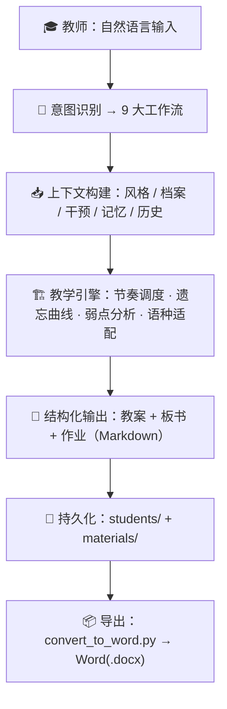

# AI Language Tutor — 语言家教备课 Skill

> 面向一对一语言家教（教师）的 AI 备课技能：把「备课—上课—诊断—记忆管理」全流程沉淀为自然语言可触发的结构化工作流，实现**长期学生记忆 + 自适应教学智能**。

这是一个 [Codex Skill](https://developers.openai.com/codex/)。教师用一句话即可完成原本数小时的备课：建学生档案、生成 5 模块同步教案、板书文档、分层作业、诊断报告，并自动追踪遗忘曲线。

## 核心能力

- **学生档案管理** — 30+ 字段的完整学习档案，随课程推进自动更新
- **5 模块同步教案** — 语法 / 词汇 / 课文对话 / 听力 / 练习五大模块按可配比例同步推进
- **三件套一次产出** — 每次备课同时生成教案、板书文档（平板当黑板）、作业
- **遗忘曲线与知识点追踪** — 间隔重复（1/3/7/15/30 课），自动标注复习优先级
- **板书图片分析** — 只提取结构化教学摘要，不存储原始 OCR
- **教学风格与干预系统** — 全局风格 → 学生档案 → 逐课 override 三层参数化，教师始终拥有最终控制权
- **Markdown → Word 一键交付** — 自研脚本批量转 .docx，板书模式自动切换平板大字排版

## 支持语种

英语、粤语（可扩展）。同一套系统通过档案、干预、风格三层参数化实现语种与学情的差异化适配。

## 目录结构

```text
ai-language-tutor/
├── SKILL.md                     # 技能入口：核心规则 + 工作流路由 + 参考索引
├── README.md                    # 本文件
├── agents/
│   └── openai.yaml              # UI 元数据
├── references/                  # 按需加载的详细规则
│   ├── workflows.md             # 9 大工作流分步操作与输出格式
│   ├── teaching-methods.md      # 5 模块同步、时长分配、遗忘曲线、检索、语种教学法
│   ├── data-schemas.md          # 数据结构与字段语义
│   └── templates.md             # 教案/板书/作业/课程总结模板
└── scripts/
    ├── convert_to_word.py       # Markdown → Word 转换器
    └── convert_to_word.bat      # Windows 一键转换
```

## 快速开始

### 安装（任选其一）

```bash
# 方式一：git clone
git clone https://github.com/Vortex556/ai-language-tutor.git ~/.codex/skills/ai-language-tutor

# 方式二：下载 ZIP，解压后把 ai-language-tutor-main 改名为 ai-language-tutor，
#         复制到 ~/.codex/skills/ 下
```

安装后重启 Codex（或新开会话），然后在任意工作目录用自然语言发起备课，例如：

```
给张三建个档案，学英语，A2 水平
给张三备一节 60 分钟口语课
给张三出上一节课的作业
诊断一下张三现在什么水平
分析这张板书照片 [图片]
更新张三的记忆曲线
```

3. 学生数据会持久化在当前工作目录的 `students/` 下，与技能本体分离，方便备份或替换。

## 9 大工作流

| # | 工作流 | 触发示例 |
|---|---|---|
| 1 | 创建学生档案 | 「给张三建个档案，学英语」 |
| 2 | 生成教案（三件套） | 「给张三备一节 60 分钟口语课」 |
| 3 | 生成作业 | 「给张三出上一节课的作业」 |
| 4 | 诊断学生 | 「诊断一下张三现在什么水平」 |
| 5 | 板书分析 | 「分析这张板书照片」 |
| 6 | 更新记忆状态 | 「更新张三的记忆曲线」 |
| 7 | 管理素材 | 「搜一下现在完成时的练习素材」 |
| 8 | 教学风格 | 「我上课风格偏幽默，纠错委婉些」 |
| 9 | 教师干预 | 「下节课张三必须复习第三人称单数」 |

## 架构总览



三层覆盖系统：`teacher_style.json`（全局默认）→ `profile.json`（学生档案）→ `override.json`（单课干预），逐层继承与覆盖，教师拥有最终控制权。

## 教学法模型

**5 模块同步教学**：每节课同步推进语法、词汇、日常交流对话/课文、听力素材练习、题目练习五大板块，不做单一模块集中教学。默认课时 150 分钟（范围 150–180），始终保留 5–10 分钟弹性缓冲。详见 `references/teaching-methods.md`。

**遗忘曲线引擎**：新知识点 `mastery=0.3, retention=1.0`；未复习每节衰减 0.1–0.2，复习则重置并提升掌握度；按留存度分 URGENT / HIGH / MEDIUM / LOW 四档，间隔 1/3/7/15/30 课复习。

## 技术栈

- Codex Skills（SKILL.md + references + scripts）
- Markdown + YAML Frontmatter
- JSON（文件系统作为数据库）
- Python（python-docx、pyyaml）— Markdown → Word
- 间隔重复算法（Spaced Repetition）

## 导出 Word

```bash
pip install python-docx pyyaml
python scripts/convert_to_word.py students/STU001/lessons
```

脚本自动识别文档类型（教案 / 课程总结 / 作业 / 板书 / 板书分析）并套用对应排版；板书为平板大字模式（H1 26pt 居中、正文 14pt、对话 13pt）。

## License

待定（可按需添加，建议 MIT）。
